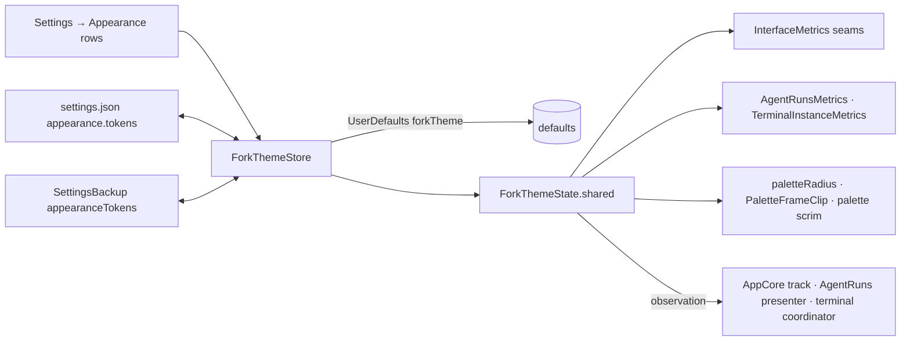

# Appearance and theme tokens

Fork-owned. **Settings → Appearance** holds what used to be General's Appearance section, a colour
theme (Colours), then one section of design tokens per component: Agent Card, Terminal Instance and
Palette. Each token
defaults to the value the component drew before it existed, persists, travels in settings backups and
in the opt-in settings.json mirror, and can be reset on its own or with its whole section.

## Invariants

- **An unset token changes nothing.** Every default restates the `Theme` token (or text style) the
  component read before, and the palette seams fall back to upstream's own expression while unset,
  so `InterfaceMetrics.standard` is still `Theme` verbatim. Setting a token to its default value
  clears the override instead of storing it.
- **One store, one live value.** `AppCore.forkTheme` (`ForkThemeStore`) owns persistence; it
  publishes a `ForkTheme` value to `ForkThemeState.shared`, which every reader uses through
  `ForkTheme.current`. The state is observable by hand and lock-guarded, so a SwiftUI body, an
  AppKit `withObservationTracking` sink and nonisolated `InterfaceMetrics` code all read the same
  value, and a change re-renders live with no relaunch.
- **Lengths are points at the standard Interface Size.** A token whose kind `scales` goes through
  `metrics.scaled`, so Large and Larger keep multiplying it. Hairline widths, the terminal grid's
  font size and its insets do not scale, as before.
- **The palette is upstream's, so it changes only through seams.** `InterfaceMetrics` (row padding,
  row radius, header padding, search-field size), `PaletteChipsCoordinator.paletteRadius` (the
  window's corner, fork-owned), `PaletteFrameClip` (the border, fork-owned) and one scrim line in
  `RootPaletteView`. Nothing else in an upstream view reads a token.
- **Unset colours stay adaptive.** A colour token holds one sRGB value for both appearances; unset,
  the surface keeps its own `ramp` ink (`Theme.Colors.border`, the model label's secondary or
  tertiary ink).
- **Inherited defaults follow their source until set.** Agent Card and Terminal Instance corner
  radius follow Palette's corner radius; the terminal bar height follows the compact bar
  (`headerHeight` plus twice Palette's header padding).

## How it flows



## Files

| File | Role |
| --- | --- |
| `Fork/Theme/ForkThemeToken.swift` | Every token: component, key, kind and range, title, subtitle, search keywords. Foundation only |
| `Fork/Theme/ForkThemeValue.swift` | A number, flag or `#RRGGBBAA` colour; its plist and Codable spellings, clamping |
| `Fork/Theme/ForkTheme.swift` | The overrides and every lookup: defaults, `points` at an Interface Size, fonts, scrims |
| `Fork/Theme/ForkThemeState.swift` | The live value, behind a mutex, with its own `ObservationRegistrar` |
| `Fork/Theme/ForkThemeStore.swift` | Persistence, set/reset, backup gather and restore |
| `Fork/Theme/ForkThemeSettingsFile.swift` | The `appearance.tokens` binding |
| `Fork/Appearance/AppearanceSettingsView.swift` | The pane |
| `Fork/Appearance/ForkThemeSection.swift`, `ForkThemeTokenRow.swift` | A component's section and one token's row |
| `Fork/Appearance/ForkThemePreviews.swift` | Live previews from `AgentRunsPreviewData` and `TerminalInstancesPreviewData` |
| `Fork/ForkSettingsSearch.swift` | The pane, section and per-token search entries and anchors |

## Tokens

Defaults are at the standard Interface Size. "Scales" means Large and Larger multiply the value.

| Key (`component.token`) | Default | Range | Scales |
| --- | --- | --- | --- |
| `agentCard.horizontalPadding` | 12 pt (`Spacing.xl`) | 0–48 | yes |
| `agentCard.verticalPadding` | 6 pt (`Spacing.sm`) | 0–24 | yes |
| `agentCard.gap` | 8 pt (`Spacing.md`) | 0–32 | yes |
| `agentCard.paletteMargin` | 12 pt (`Spacing.xl`) | 0–48 | yes |
| `agentCard.cornerRadius` | Palette corner radius | 0–40 | yes |
| `agentCard.scrimOpacity` | 0 (glass only) | 0–100 % | — |
| `agentCard.border`, `.borderWidth`, `.borderColor` | off, 1 pt, `Colors.border` | 0.5–6 | no |
| `agentCard.titleFontSize` | `.body` (13 pt) | 9–32 | yes |
| `agentCard.detailFontSize` | `.caption1` (10 pt) | 8–24 | yes |
| `agentCard.trailingFontSize` | `.callout` (12 pt) | 8–24 | yes |
| `agentCard.dotSize` | 6 pt | 2–16 | yes |
| `agentCard.dotGap` | 20 pt (`Spacing.xxl`; the row's own gap was 10) | 0–40 | yes |
| `agentCard.modelColor` | secondary, or tertiary after an agent name | colour | — |
| `terminalInstance.barHeight` | compact bar (64 pt) | 32–120 | yes |
| `terminalInstance.gutter` | 16 pt (`Spacing.md * 2`) | 0–48 | yes |
| `terminalInstance.cornerRadius` | Palette corner radius | 0–40 | yes |
| `terminalInstance.divider`, `.dividerWidth` | on, 1 pt | 0.5–6 | no |
| `terminalInstance.gridFontSize` | 12 pt | 8–24 | no |
| `terminalInstance.outputInsetHorizontal` | 20 pt (`Spacing.xxl`) | 0–48 | no |
| `terminalInstance.outputInsetVertical` | 4 pt (`Spacing.xs`) | 0–24 | no |
| `palette.cornerRadius` | 26 pt (`Radius.panel`) | 0–40 | yes |
| `palette.rowPadding` | 6 pt (`Spacing.sm`) | 0–24 | yes |
| `palette.rowCornerRadius` | 10 pt (`Radius.row`) | 0–20 | yes |
| `palette.searchFieldFontSize` | 20 pt | 9–32 | yes |
| `palette.headerPadding` | 10 pt (`Size.headerPadding`) | 0–24 | yes |
| `palette.scrimOpacityDark`, `.scrimOpacityLight` | 40 %, 55 % (`panelScrim`) | 0–100 % | — |
| `palette.border`, `.borderWidth`, `.borderColor` | off, 1 pt, `Colors.border` | 0.5–6 | no |

What each one reaches, beyond its own component:

- `palette.rowPadding` and `palette.rowCornerRadius` apply to every list row in the palette and its
  screens, extension lists included, because they share `InterfaceMetrics`. Row corner radius also
  rounds the row-sized tiles that already read `Radius.row` (app and entry icon tiles, inline argument
  fields). The fitted presentation's row height (`PalettePresentation.rowHeight`) uses the same padding.
- `palette.headerPadding` sets the compact bar's height, so the compact window, the chips and the
  terminal bar (until set) follow it.
- `palette.searchFieldFontSize` also sizes the terminal bar's command text, which reuses the field's face.
- The palette scrim also dresses the terminal card. Dialogs, HUDs, Notes and the camera keep `panelScrim`.
- `palette.cornerRadius` changes the palette window (and the cards, until set), not dialogs.
- The card height grows to fit larger fonts; at default sizes it stays one launcher row plus padding.

## Colour themes

A colour theme is ten slots, modelled on Slack's custom theme. Nil (**Tinycast (default)**) is the
adaptive look exactly, with the Dark/Light/System Theme picker in charge; any other theme pins the
app to its base appearance, so the picker is dimmed and labelled. The base is dark when the
background's WCAG luminance is under 0.179, mid-grey's, and decides the glass, vibrancy and
`NSApp.appearance` (`AppCore.applyAppearance`, hook `color-theme`).

There is no second colour system. `ForkColors.adaptive`, the one resolver every `Theme.Colors` `ramp`
and `adaptive` token goes through, asks the theme first (`ForkColorPalette.color(forUpstream:light:)`),
memoised per pair:

| Slot | Upstream tokens it becomes | Fork surfaces |
| --- | --- | --- |
| Window background | `panelScrim` at 85 % | palette scrim (`paletteScrim`), Window gradient's top |
| Surface | — | agent card wash at 85 %, Window gradient's bottom |
| Text | `textPrimary`; every other `ramp` token as text at its own alpha | grid foreground |
| Secondary text | `textSecondary`, `textTertiary` (75 %) | — |
| Accent and selection | `selection`, `menuHover` (28 %), `rowHover` (12 %); the SwiftUI tint and accent colour | working dot, spinner, grid cursor |
| Border | `border`, `separator` and `cardStroke` (70 %) | card borders when their colour is unset |
| Success, Warning, Error | — (`Theme.Colors.success/warning/destructive` are fixed hues in `Theme.swift`, which the audit pins) | blocked dot, terminal notices and crash glyph |
| Terminal background | — | terminal card scrim, grid background |

Translucent `adaptive` pairs that aren't the ramp (find marks, dimming, the layout-preview plate) stay
upstream's. A themed scrim is 85 % opaque over the glass unless the palette's scrim token for the
theme's base is set, which then wins. A new theme rebuilds each hosting tree once
(`ForkAppearanceScope`'s id), because a dynamic colour already drawn never asks again.

Text and Secondary text are raised toward white (dark base) or black (light base) in 5 % steps until
they reach 4.5:1 against the background; the pane names each adjusted slot and its original ratio.
Ayu (all three), Cursor Dark and Material adjust Secondary text; GitHub and Monokai Pro pass as written.

**Terminal.** The ghostty grid takes Text, Terminal background and Accent (cursor) as its default
colours, and the 16 ANSI colours from the preset or an imported VS Code file, as data rather than
slots: they are not editable. A program's own OSC colours still win; `TerminalLogView` keeps its own.

**Importing.** A theme string (Slack's comma-separated `#RRGGBB`, any count up to ten) fills the slots
in order and derives the rest: surface and border mixed from background and text, accent and status
from the system palette. A VS Code theme file (JSON with comments) maps first-present keys: surfaces
composite over `editor.background`, inks drop their alpha. "Copy Theme String" writes all ten.

| Slot | VS Code keys, first present wins |
| --- | --- |
| Window background | `editor.background` |
| Surface | `sideBar.background`, `panel.background`, `editorWidget.background` |
| Text | `editor.foreground`, `foreground` |
| Secondary text | `descriptionForeground`, `editorLineNumber.foreground` |
| Accent and selection | `textLink.foreground`, `activityBarBadge.background`, `focusBorder`, `button.background` |
| Border | `panel.border`, `editorGroup.border`, `widget.border`, `contrastBorder` |
| Success | `terminal.ansiGreen`, `gitDecoration.addedResourceForeground` |
| Warning | `editorWarning.foreground`, `terminal.ansiYellow` |
| Error | `editorError.foreground`, `terminal.ansiRed` |
| Terminal background | `terminal.background`, `panel.background` |

**Presets** (`ForkColorThemePreset`) are exactly what that mapping reads from each official file
(checked by importing each file and comparing all slots and ANSI colours):

| Preset | Source fetched (2026-10-10) |
| --- | --- |
| GitHub Dark, GitHub Light | `GitHub.github-vscode-theme` 6.3.5, `themes/dark-default.json`, `light-default.json`: https://marketplace.visualstudio.com/_apis/public/gallery/publishers/GitHub/vsextensions/github-vscode-theme/latest/vspackage |
| Ayu Dark, Mirage, Light | https://raw.githubusercontent.com/ayu-theme/vscode-ayu/master/ayu-dark.json, `ayu-mirage.json`, `ayu-light.json` (same path) |
| Material | `Equinusocio.vsc-material-theme` 34.7.16, `build/themes/Material-Theme-Default.json`: https://marketplace.visualstudio.com/_apis/public/gallery/publishers/Equinusocio/vsextensions/vsc-material-theme/latest/vspackage |
| Cursor Dark | Cursor 3.22.7's own bundle, `Cursor.app/Contents/Resources/app/extensions/theme-cursor/themes/cursor-dark-color-theme.json`; Cursor publishes no repository for it |
| Monokai Pro | `monokai.theme-monokai-pro-vscode` 2.0.16, `themes/Monokai Pro.json`: https://marketplace.visualstudio.com/_apis/public/gallery/publishers/monokai/vsextensions/theme-monokai-pro-vscode/latest/vspackage |

**Preview and apply.** The Colours section edits a draft: picking a preset, editing a slot (swatch,
hex, pencil) or importing changes only the preview (palette rows, an agent card and a terminal card,
the real card views under `\.forkColorPreview`). **Apply** commits it; **Revert** drops the draft.
Fork card views draw through `ForkInk`, which reads the previewed palette, else the live one, else
`Theme.Colors`.

## Persistence

- **UserDefaults:** one dictionary under `forkTheme` (`AppSettingsKey.forkTheme`), keyed
  `component.token`; numbers and flags as plist values, colours as `#RRGGBBAA`. The colour theme is
  its `colorTheme` entry: `{preset, slots: {slot: hex}, ansi?, windowGradient}`. Unknown keys and
  unusable values are ignored at load. An empty set removes the key.
- **settings.json:** `appearance.tokens`, an object per component holding only changed tokens:

  ```json
  "appearance": {
    "tokens": {
      "agentCard": { "cornerRadius": 18, "border": true, "borderColor": "#FFFFFF33" },
      "palette": { "rowPadding": 4 },
      "colorTheme": { "preset": "ayu-mirage", "slots": { "accent": "#F28779FF" }, "windowGradient": false }
    }
  }
  ```

  The record rule applies: a token the file leaves out keeps its value, `null` resets it, an unknown
  token or a value outside its kind is reported and skipped, and a number outside its range is clamped.
  `colorTheme` needs a known preset id or `custom`; `null` returns to Tinycast's look. Its slots are
  only those changed from the preset; a custom theme derives the slots it lacks.
  The key is `appearance.tokens`, not `appearance.theme.*`, because `appearance.theme` is upstream's
  Dark/Light/System choice.
- **Backups:** `SettingsBackup.SettingsData.appearanceTokens` (`ForkThemeBackup`), the same flat map
  plus a `colorTheme` entry, so older backups still read. Importing replaces the whole token set and
  the theme, as a list field does; neither grants a capability, so both travel.

## Adding a token

1. Add a case to `ForkThemeToken` (`"component.name"` raw value; case order is display order), with its
   `kind`, `title`, and a `subtitle` only if the title leaves out a consequence.
2. State its default in `ForkThemeToken.defaultNumber(in:)` by restating the `Theme` token the
   component reads today (or in `defaultFlag`); a colour has no default.
3. Read it in the component through `ForkTheme.current` (or the component's metrics struct): lengths
   via `points(_:_:)`, fonts via `font(_:style:_:)`, which is nil while unset so the style stands.
   An AppKit frame that depends on it must observe `ForkTheme.current` where it already re-lays out.
4. Nothing else: the row, its search entry, settings.json, defaults and backups all enumerate the cases.
   A new component also needs a `Component` case, a `SettingsAnchor` in `ForkSettingsSearch` and a
   `ForkThemeSection` in the pane.

An upstream surface takes a token only through an existing seam (`InterfaceMetrics` first). A token
that needs edits in many upstream views gets a named metric instead, as `spacing.rowVertical` did.

## Not supported

- **Palette row height as one number.** Rows differ (one line, two lines, icons of different sizes), so
  the token is the vertical padding inside every row, which sets their height consistently.
- **Terminal output insets and font size on the fallback log.** They apply to the ghostty grid (the
  default renderer). With `forkTerminalGhostty` off, upstream's `TerminalLogView` keeps its own inset
  and system monospaced face, and the card's height maths uses the token insets.
- **Per-appearance colour tokens.** A colour override is one value; the unset state is the adaptive one.

- **Status colours on upstream surfaces.** `Theme.Colors.success`, `warning` and `destructive` are
  fixed `Color`s in `Theme.swift`, which the fork audit pins to upstream except the adaptive resolver,
  so dialogs and HUDs keep the system hues; fork cards use the theme's.

## Verification

Build both schemes, then in Tinycast Dev: change each token and watch the preview, the palette, the
agent stack (with runs) and an open terminal card update without relaunching; Large and Larger
Interface Size; reset one token and a whole section; quit and relaunch to check persistence; with
settings.json on, edit `appearance.tokens` (including `null`, an unknown token and a bad value) and
change a token in the app to see it written; export and import a backup. Check over a light desktop
in both appearances. The previews in Settings are the real card views over sample data.
