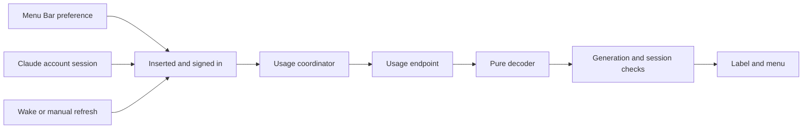

# Claude usage in the menu bar

The Claude usage item shows Claude plan limits through an independent `MenuBarExtra`.
Its **Menu Bar** picker follows the sign-in controls in Claude Account settings.
The choices are **Disabled**, **Usage Icon**, **Session Percent**, and **Session and Week**.
The default is **Disabled**.

## Invariants

- `AppCore` owns `ClaudeUsageCoordinator` and starts and stops its lifecycle.
- The display preference alone inserts the item. Dragging the item out writes **Disabled**.
- The item leaves Tinycast's launcher and calendar preferences unchanged.
- Usage requests require both an inserted item and a signed-in Claude account.
- The coordinator reuses `ForkClaudeAccount` tokens and validates the account session after suspension.
- Each request sends `GET https://api.anthropic.com/api/oauth/usage` with only the bearer authorization header.
- The private session uses an ephemeral configuration, no URL cache, and no cookie storage.
- Snapshots, update times, and errors stay in memory. Only the display preference is persisted.
- The pure model imports Foundation and receives the locale, time zone, and clock from callers.

## Display and decoding

The gauge symbol is `gauge.with.dots.needle.50percent`.
Every mode shows the gauge until a snapshot supplies the required values.
**Session Percent** shows a whole percentage, such as `42%`.
**Session and Week** shows `42% · 18%` when both windows exist.
A missing weekly window leaves only the session percentage; a missing session leaves the gauge.
Percentages round to the nearest integer, with ties away from zero.
The label's accessibility text names Tinycast and the displayed values.

The decoder prefers the `limits` array.
When that key is absent, it reads `five_hour` and `seven_day`.
An explicit empty array reports no windows; a null array is malformed.
Percentages must be finite numbers from 0 to 100.
Reset timestamps accept fractional seconds and explicit offsets.
Malformed windows reject the complete response, preserving the previous snapshot.
Unrelated keys and null metadata do not contribute windows.

The menu orders session, all-models weekly, model-scoped weekly, and unknown windows.
Windows within each group retain response order.
Scoped names use the server's model display name followed by **weekly**.
Unknown windows keep their raw kind.
Every row shows its percentage and local reset date and time.
The menu ends with **Refresh Now** and **Claude Account Settings…**.
The settings action opens the Claude account's provider panel.
Signed out, the menu offers **Sign In to Claude…** and disables **Refresh Now**.

## Refresh lifecycle

Polling starts immediately when the item is enabled and the account is signed in.
The coordinator schedules subsequent polls every five minutes.
Wake and manual refreshes also fetch while both conditions hold.
A newer fetch cancels its predecessor and replaces its generation identifier.
Disable, sign-out, and termination cancel polling and in-flight requests.
Cancellation, generation, preference, and account-session checks reject stale results.
An account-session change clears the previous account's snapshot.

A 401 triggers one retry through `accessToken(sessionID:rejectedToken:)`.
A second 401 displays an error without invalidating the account's refresh token.
The account retains responsibility for signing out when its refresh token is rejected.
A 429 waits until the next scheduled poll, including requests from wake and manual actions.
Other failures retain the previous values and show a one-line error.
When a previous snapshot exists, the error section also shows **Updated N min ago**.

## Settings and source ownership

`ClaudeUsageSettings.display` stores `fork.claudeUsage.menuBar` in the app's defaults domain.
`SettingsFileKey.claudeUsageMenuBarDisplay` mirrors it as `ai.claudeUsageMenuBar` in `settings.json`.
Its values are `disabled`, `usageIcon`, `sessionPercent`, and `sessionAndWeek`.
Settings search finds the picker through **Menu Bar** and Claude usage keywords.
The scene reads only this preference; polling updates the label and menu independently.

Implementation lives in `Tinycast/Fork/ClaudeUsage/`.
`Tests/claude-usage-model-test.swift` exercises the shipped decoder, formatter, and polling policy.
`Scripts/run-tests.sh` registers that harness.
The [fork hook table](../fork.md#upstream-hooks) records upstream integration points.

## Open questions

The endpoint is undocumented.
Claude and Sasha verify Tinycast login scopes during the native check in task 5.1 before accepting the feature.
The [scope question](../../openspec/changes/claude-usage-menu-bar/design.md#q-Q2) records that check.
