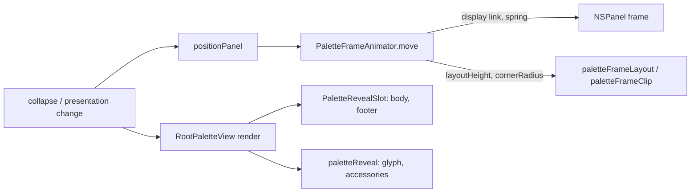

# Palette motion

Fork-owned (`Tinycast/Fork/Motion/`). The palette window animates between its presentations
(compact bar, fitted, bar, standard) and the blocks inside it enter and leave with a short,
staggered reveal. A screen declares nothing to get this: any change that moves the window or
swaps the body animates through the same path.

## Invariants

- The top edge never moves. The window grows and shrinks from its anchored top, so the search
  bar holds still during the compact swap (testing.md, compact swap).
- While the window moves, the content lays out at the larger of the two heights and the window
  clips it. Rows, the empty state and the footer never reflow per frame; the edge reveals them.
- A hidden window, Reduce Motion or an unchanged frame jumps straight to the target, as before.
  The first frame of a summon is always placed without animation.
- A shrink waits `collapseDelay`, so the body and footer have faded before the edge passes them.
  A move in flight is retargeted with its velocity carried over, never restarted.
- A leaving block renders its last content until its fade ends and takes no clicks meanwhile.
- With Reduce Motion on: resizes are instant, leaving blocks vanish at once, and entrances are a
  short cross-fade with no offset and no stagger.

## Tokens

All numbers live in `PaletteMotion`.

| Token | Value | Used for |
| --- | --- | --- |
| `windowSpring` | `Spring(duration: 0.34, bounce: 0)` | The window frame and corner radius |
| `collapseDelay` | 0.08 s | Hold before a shrink starts |
| `stagger` | 0.035 s per `order` | Delay between the window starting and a block entering |
| `revealDuration`, `revealCurve` | 0.28 s, bezier (0.2, 0.8) (0.2, 1) | A block's fade and slide home |
| `fadeDuration` | 0.15 s | The Reduce Motion entrance |
| `exit` | ease-in 0.1 s | A leaving block's fade |

| Reveal | Order | Starts from | On |
| --- | --- | --- | --- |
| `.glyph` | 0 | in place | Header leading glyph (magnifier, back chevron) and placeholder |
| `.accessory` | 1 | 8 pt right | Trailing header controls (Quick AI model and reasoning menus) |
| `.body` | 2 | 14 pt below | The screen body, on expansion and on every mode change |
| `.footer` | 3 | 8 pt below | The footer, when it appears |

## How it flows



`PaletteFrameAnimator` is owned by `PaletteWindowController` and injected into the palette
tree. It drives the frame from a `CADisplayLink` sampling `windowSpring`, rounded to device
pixels so the glass and clip share an edge. It interpolates the corner radius from the old
presentation's radius to the new one, and invalidates the shadow when it settles. Only the
two small modifiers read its observable state, so `RootPaletteView.body` is not re-evaluated
per frame.

## Opting in

A block that comes and goes with a branch replays on insertion; one that stays put replays when
a key changes; one that must also fade out on removal goes in a slot:

```swift
MyHeaderButton(...).paletteReveal(.accessory)
Text(title).paletteReveal(.glyph, on: title)
PaletteRevealSlot(.body, isPresented: showsPanel, key: mode) { MyPanel() }
```

A new reveal is a `PaletteMotion.Reveal(order:offset:)`; add a static preset when a second
caller needs it. A new window height needs nothing: any frame `positionPanel` computes animates.

## Verifying

Run against Tinycast Dev with Window mode set to Compact, then repeat with Reduce Motion on
(System Settings ▸ Accessibility ▸ Display):

- Empty compact bar, ⇥ into Quick AI: the panel grows down from a fixed top; the chevron and
  "Ask anything…" fade in; the model and reasoning menus slide in from the right; the empty
  state and then the footer rise in.
- ⎋ back: the body and footer fade, then the panel collapses to the bar.
- Type one letter, then delete it: the results expand and collapse the same way.
- With Reduce Motion: every resize is instant and the blocks only cross-fade.
