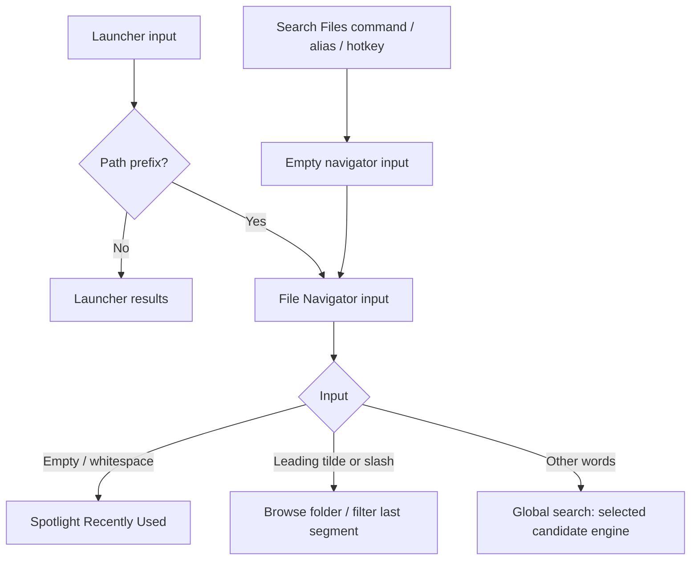

# File Navigator search mode — spec and implementation plan

> **For agentic workers:** Execute this plan task-by-task per the global CLAUDE.md Orchestration policy (delegate to executor/mech-executor roles, verifier pass before done). Steps use checkbox (`- [ ]`) syntax for tracking.

**Goal:** Search Files opens the File Navigator with empty input and Recently Used files; paths browse and words search within that same screen.

**Architecture:** Keep the AppCore-owned `FileNavigatorCoordinator` and its independent `FileSearchSession`. Port the type-filter control and blank-query recents before changing entry points. Reuse upstream search services and preview surfaces, but route no entry point to upstream `FileSearchScreen`.

**Tech Stack:** Swift 6 strict concurrency, SwiftUI, AppKit, Observation, Spotlight MDQuery, fork-owned ripgrep/fzf services, standalone Swift harnesses.

**Authority:** Sasha's settled decision, 2026-10-11. Read against the current, concurrently edited `al/file-navigator` tree; symbol names below identify edit sites, not frozen line numbers. This document proposes implementation; it records no build, runtime or harness evidence.

**Order (Sasha's rule):** Tasks 1–6 implement with **no test edits or new harnesses** and no builds, tests or lint. Claude verifies in Task 7; Sasha checks in Dev in Task 8; harness changes come last in Task 9. This planning task writes this file only and runs none of those commands.

---

## Part A — proposed spec section

## Search mode

### One screen and its entry points

**Search Files opens File Navigator in search mode**, with empty input, global scope and the type filter reset to All Types. Browse Files still starts at the last browsed folder, otherwise home. Neither command creates another coordinator or search index.

- Keep `CommandID.searchFiles`, `command:search-files`, its title, symbol, visibility preference, alias and `.command(.searchFiles)` hotkey identity. ⌥F is an example user binding, not a new shipped default; whatever chord is already bound keeps working.
- Selecting Search Files by name or alias opens empty input, rather than searching the command/alias text. The existing Search Files fallback carries the launcher's actual query, including a pasted path.
- The File Search pane **keeps ownership** of the Search Files command row through `SettingsTab.ownedCommands` in `CommandCatalog.swift`. Keep `fileSearch.commands`; Browse Files stays under `fileNavigator.commands`. Screen ownership does not require moving command preferences, duplicating rows or migrating aliases and shortcuts.
- Keep Enable File Search as the gate for the Search Files command, alias entry, fallback and hotkey. Hiding its launcher row still leaves its hotkey working. Disabling it exits an active session entered through Search Files to the launcher, without hiding the palette. An independently opened navigator can still search while this switch is off, as it can today.
- Repeating the unseeded Search Files invocation while its own navigator session is visible hides it, even after browsing within that session. Invoking it from an independently opened navigator starts a fresh empty search. A seeded fallback always opens with its supplied query.

Only launcher path prefixes automatically enter File Navigator. Ordinary words typed at the launcher remain launcher search. Once inside File Navigator, the input determines the mode; entry provenance determines only exit/gating behaviour.



Retain the existing prefix grammar: bare `~` or `/` at the launcher seeds `~/`; `~/…` and `/…` preserve their path. Inside the navigator `/` names filesystem root. A slash within words, such as `agentkit/lib`, remains a global query. Invalid absolute paths show the existing missing-folder state, never global results or an inferred nearby folder.

### Empty input, typing and the type filter

Empty or whitespace-only global input requests **Recently Used**, using the independent session's existing `search("", filter:)` path. Keep Spotlight recents under either engine: used within 30 days plus changed within 3 days, merged newest first, at most 20 rows, no typing debounce. These are files from system metadata, distinct from the navigator's persisted recent **folders** in ⌘B. No new usage history is recorded.

Nonblank global input searches the configured Search Scopes and Ignore Patterns through the selected engine. Preserve the existing 120 ms debounce, fzf extended syntax, cancellation and candidate/result limits. Do not rerank recents alphabetically or run a second navigator filename-only ranking pass over global results.

| Source | Search-mode contract |
|---|---|
| Spotlight | Existing substring batch, supplemental fuzzy glob when eligible, merge/ranking, 1,000 candidates per query and 200 displayed rows; type predicate runs before retrieval caps. Home expansion, cloud roots and hidden-path exclusions remain upstream. |
| ripgrep | Existing shared home snapshot, restricted to configured scopes; ready index replaces Spotlight retrieval. While building, use Spotlight then publish the indexed answer only for the still-current request. Outside-home scopes fall back to Spotlight for the whole query. |
| ripgrep limitations | No new scope index or content search. Preserve dot-entry inclusion, ignore rules, `.gitignore`, fixed home Library/Trash and `.git` exclusions, package boundaries and absence of empty directories. Content-type metadata is checked after its bounded candidate heap, so narrowing can underfill results. |
| Recents / failures | Recents always use Spotlight; missing/unlaunchable rg uses the current fallback. Empty scopes produce no global results or recents. Query failure says “File search is unavailable”; empty completed words use the filter's empty message; no recents says “Type to search files and folders”. |

Port the header's **All Types** menu, backed by unchanged `FileSearchFilter`: All Types, Folders, Documents, Images, Audio, Videos, Archives. Button and ⌘P open the same palette menu, highlighting the current value; ↑/↓ select, ↵ applies, Escape dismisses without changing the query. Choosing a filter resets focus/scroll and reissues the query, including recents. The filter is part of request identity, never a filter over 200 already returned rows.

Keep `PaletteState.fileSearchFilter` as the single transient filter value. Reset on a fresh summon; preserve it while browsing a result and restore it on returning to search. **Apply it only to global words and recents.** Hide its header button and leave ⌘P unhandled during direct browsing or Search Below, so a remembered Images filter cannot hide navigable folders. Local subtree filtering remains the existing path-segment fzf filter.

⌘⇧. is recognised everywhere by the same navigator handler. It changes the reveal preference for direct folder listings only; global results, recents and recursive exclusions retain their source policy. Toggling it during search must neither rebuild the index nor restart the search. It takes effect on the next direct listing.

### Selection, actions and keys

Use `FileNavigatorAction` and `FileNavigatorScreen` for browse rows, global hits and recents. ↑/↓ move focus; Tab completes the selected path; ↵ descends into a folder when there are no picks, otherwise opens Actions. A file's first action remains Edit in Fresh; Open with default app stays available. Double-click follows the same activation rule as ↵.

Space continues to type spaces in global queries and to pick/unpick in browse/subtree mode. **⌥Space picks/unpicks the focused row in every mode**, including recents; ⌘A picks all visible rows. IME composition and open-menu ownership take precedence. Picks survive query, filter and directory changes until explicitly cleared or the navigator closes; only proven missing paths are removed automatically.

| Context | Folder used by folder actions | Additional action rules |
|---|---|---|
| Direct listing / Search Below | Current browsed folder | Search Below searches it; direct listing omits Show in File Navigator. |
| Global hits / recents | One selected folder itself, or one selected file's parent; for picks, only if all targets resolve to that same folder | Show in File Navigator requires exactly one effective target and opens its **parent**, focusing the target after loading. Search Below enters the resolved folder's subtree. |
| Global with no target or picks spanning folders | No action folder | Omit Ghostty actions, Copy relative paths, Search Below and Bookmark folder; retain applicable multi-target open/edit/absolute-copy/reveal/agent actions. Never use a stale last-browsed folder. |

⌘F toggles Search Below in a browse folder; from global results/recents it enters Search Below for the resolved action folder. ⌘O/⌘T use that same folder for Ghostty app/embedded terminal; consume these chords harmlessly when no folder resolves. Ctrl-G requires an originating terminal **and an actual browse folder**; global results cannot cd to a remembered location. All external actions revalidate their actual target URLs and required directory after suspension.

⌘Y toggles the default preview pane, ⌘⇧Y expands/collapses it, ⌥↑/↓ pages it and ⌥⇧↑/↓ jumps to its ends. Keep focus in the input and the current preview/provider limitations. Quick Look remains an action using the in-palette overlay; it has no separate ⌘Y binding. Bookmarks, agent-context copying and multi-file editing retain navigator semantics.

### Back, Escape and lifecycle

Remember one search return context when global input first becomes a path, including through Tab, folder activation, Show in File Navigator or Search Below: query, type filter and focused **path**, not a stale row index. Further browsing updates do not overwrite it. Back restores that search; focus the saved path if still present, otherwise the first result. Starting a new global query directly abandons the older return context. Picks and preview preference survive this internal return.

Back means the header back control. It restores the search return context first; otherwise a command entered over an existing palette returns to its invoking palette frame. A hotkey invoked with the palette hidden has no outer frame and closes. A navigator entered by typing a launcher path returns to an empty launcher, avoiding re-triggering that path.

Escape takes one step per press: dismiss the open menu/Quick Look overlay; collapse expanded preview; clear nonblank global words to recents or trim a browse filter to its folder; clear picks; leave Search Below; then take Back. Missing-folder recovery still returns to the last verified folder, otherwise home. Shift-Tab retains parent-folder/recovery behaviour and does nothing on global input. ⌘Escape retains the palette's immediate root-search action.

Clearing input in a command-opened navigator (Search Files or Browse Files, including terminal entry) stays in File Navigator and shows recents. Clearing input after typed-path launcher entry returns to the launcher, including after the user switched from a path to words. Bare Backspace on already empty command-opened input is consumed without navigating or closing.

Hiding/leaving cancels navigator work, the independent search session, preview and actions; clears picks, return context and fitted icons; stops the folder watcher. No watcher runs for global results/recents. Keep the shared index's existing owner, refresh and retained-snapshot lifetime. Late query/filter/configuration results cannot repopulate a departed screen.

### Routing and settings ownership

Remove `PaletteMode.fileSearch` and its launch/lifecycle branches. `FileSearchScreen`, its action menu/list and upstream coordinator action helpers remain compiled, unedited and unrouted. Search Files' coordinator gets only small marked entry/gating hooks. Continue reusing its models, session, services and preview surfaces; do not copy the upstream screen or create a second UI key map.

**Recommend keeping the current settings split.** File Search owns Enable File Search, Search Files' command row, Search Scopes and Ignore Patterns. Scopes/patterns remain editable with the command switch off because they also govern independent navigator search. File Navigator owns Browse Files, Editor command, File search engine and any future rg-specific configuration. Existing keys, backups and bundle isolation stay unchanged; add reciprocal explanatory text/search keywords rather than migrating storage. No new rg tuning preference is introduced here.

Future upstream Search Files **UI** changes require deliberate porting into File Navigator; they no longer arrive automatically. Shared service/model/preview changes still arrive through upstream merges and require normal verification.

### Search Files behaviour inventory

| Status | Behaviours |
|---|---|
| Kept | Command identity, alias, user hotkey, launcher visibility independent of hotkey, opt-in command gate, seeded fallback; scopes/ignore settings and backup keys; engine fallbacks, request supersession, recents, seven type choices, filter-specific empty/error states; preview providers and explicit Quick Look action; default-app open, reveal and absolute path copy through Actions. |
| Changed | Screen becomes navigator; ↵/double-click browse folders or open Actions for files; ⌘Y controls pane; ⌘O opens Ghostty; ⌘F searches below; Tab completes paths instead of leaving the screen; Escape/back follow the rules above; picks and expanded/scrollable preview become available; result rows show navigator paths. |
| Dropped from the routed UI | Upstream Share, Copy File (⇧⌘C), Copy Name (⌥⌘C), Paste File (⇧⌘V), Move to Trash (⌃X), direct ⌘↵ reveal, and copy-only row drag-out. No hidden fallback to `FileSearchActionsMenu`; ordinary text-field shortcuts still belong to the field. Restore any later only as a common navigator action/row capability. |
| Explicitly unchanged limits | Filename/path search only, no new permissions or content index, source-dependent hidden/empty-folder visibility, bounded queries/scans, no automatic agent dispatch. |

### Acceptance criteria

1. Existing Search Files name/alias/hotkey open one navigator with empty input, All Types and ≤20 Spotlight recents; no previously typed command name leaks into input. The File Search settings command row still edits that command's alias, binding and visibility.
2. The fallback carries its query; words search globally and a path browses. Browse Files/terminal/root-path entry retain their destinations. With the command off, no Search Files entry runs; independently opened navigator words still work.
3. Empty/whitespace input, no recents, empty scopes, unavailable Spotlight and unavailable rg show their specified states without launching an unnecessary index build for recents.
4. Every type choice reissues both words and recents, resets focus/scroll, and rejects late results from the previous filter. Browsing stays unfiltered; returning restores the filter and focused path.
5. Both engines retain their documented caps, exclusions, dot-entry/fallback differences and scoped retrieval. Rapid query/engine/scope/ignore changes and hiding never publish stale results.
6. Pick across a global query and two folders; all picks reach the same actions. Spaces remain typeable; ⌥Space and ⌘A work consistently. Missing targets produce a HUD without acting on a stale folder.
7. Show in File Navigator focuses a single result in its parent; Search Below/⌘F use the selected result's folder, then Back restores search. Multiple-folder picks cannot launch a terminal/bookmark/search in an unrelated directory.
8. Text/PDF/representative Quick Look providers support the same pane, expansion and scroll keys after every entry route; Escape dismisses layers in order and input keeps keyboard focus.
9. Command-opened empty input stays on recents; typed-path empty input returns to launcher. Back restores the invoking launcher frame or closes a hidden-palette hotkey summon. Disabling the command exits only its own session.
10. No production route or observer targets `.fileSearch`; no active screen constructs `FileSearchScreen`. Settings bindings/backups survive without migration; omitted upstream actions/dragging do not remain accidentally reachable.

---

## Part B — implementation plan

### File structure and ownership

All new behaviour belongs in existing FileNavigator files; no production file creation or project regeneration is required. Re-read concurrently changed symbols before each edit; do not replace another worker's version wholesale.

| Files | Responsibility |
|---|---|
| `Tinycast/Features/FileNavigator/Model/FileNavigatorState.swift` | Entry provenance, global/recents predicates, Escape reducer changes. |
| `Tinycast/Features/FileNavigator/Model/FileNavigatorAction.swift` | Pure target-folder resolution and contextual action availability. |
| `Tinycast/Features/FileNavigator/UI/FileNavigatorCoordinator.swift` | Search entry, return snapshot, filter requests, selection restoration, action destination validation and keys. |
| `Tinycast/Features/FileNavigator/UI/FileNavigatorScreen.swift`, `Tinycast/Features/FileNavigator/UI/FileNavigatorView.swift`, `Tinycast/Features/FileNavigator/UI/FileNavigatorList.swift`, `Tinycast/Features/FileNavigator/UI/FileNavigatorPaletteObserver.swift` | Unified actions, labels/empty states, configuration/focus observation. |
| `Tinycast/Features/FileNavigator/Service/FileNavigatorActionsAdapter.swift` | Validate URL-only versus directory-dependent actions without consulting a stale browse folder. |
| `Tinycast/Features/FileSearch/UI/FileSearchCoordinator.swift` | Minimal marked Search Files entry and disable hooks. |
| `Tinycast/Palette/RootPaletteView.swift`, `Tinycast/Palette/PaletteFilterAction.swift`, `Tinycast/Palette/PaletteMode.swift`, `Tinycast/Palette/PaletteCoordinator.swift` | Filter UI, Back, empty routing and removal of old screen mode. |
| `Tinycast/App/AppCore.swift` | Remove old-mode refresh while retaining shared-index wiring and navigator refresh. |
| `Tinycast/Features/PaletteChips/UI/PaletteChipsCoordinator.swift` | Remove dormant Files-chip route to the old mode; keep chips disabled. |
| `Tinycast/Features/FileSearch/Settings/FileSearchSettingsView.swift`, `Tinycast/Features/Settings/SettingsSearchCatalog.swift` | Correct switch/scope descriptions and searchable ownership. |
| `Tinycast/Features/FileNavigator/Settings/FileNavigatorSettingsView.swift`, `Tinycast/Features/FileNavigator/Settings/FileNavigatorSettingsSearch.swift` | Reciprocal settings guidance. |
| `docs/features/file-navigator.md`, `docs/features/file-search.md`, `docs/features/ripgrep-search.md`, `docs/features/palette.md`, `docs/fork.md`, `docs/testing.md` | Spec reconciliation, upstream hook ledger and acceptance ownership. |
| Task 9 only: `Tests/file-navigator-test.swift`, `Tests/palette-filter-test.swift`, `Tests/palette-tab-test.swift`, `Tests/file-search-session-test.swift`, `Scripts/run-tests.sh` | Confirmed behaviour coverage and source-list repairs. |

### Task 0: Establish the edit boundary

- [ ] Confirm `git branch --show-current` is `al/file-navigator`; inspect `git status --short` and the files above. Use this checkout; no branch switching, worktree, stash, reset or unrelated cleanup.
- [ ] Read `AGENTS.md`, `docs/architecture.md`, `docs/standards.md`, `docs/ui.md`, `docs/testing.md`, `docs/development.md` and the three feature specs. Coordinate file ownership before editing files another worker still owns.

### Task 1: Separate entry provenance from input mode

**Files:** `Tinycast/Features/FileNavigator/Model/FileNavigatorState.swift`; `Tinycast/Features/FileNavigator/UI/FileNavigatorCoordinator.swift`.

- [ ] Add the following pure state; leave environment facts injected and do not put filesystem reads in Model:

```swift
enum Entry: Sendable { case navigator, searchFiles, launcherPath }
var entry: Entry = .navigator
var isGlobal: Bool { if case .global = path { true } else { false } }
var isShowingRecents: Bool {
    if case .global(let words) = path {
        words.trimmingCharacters(in: .whitespacesAndNewlines).isEmpty
    } else { false }
}
var returnsToLauncherWhenEmpty: Bool { entry == .launcherPath }
```

- [ ] Extend `show(input:origin:focus:)` with `entry: FileNavigatorState.Entry = .navigator`; initialise provenance and clear the search return context before presenting. `routeRootQuery` sets `.launcherPath`. Do not change `FileNavigatorPath`'s filesystem-root grammar.
- [ ] Replace the reducer's global Escape jump to `~/` with clearing **nonblank** words to `""`; leave whitespace-only input at the recents stage. After picks, leave subtree before setting `isOpen = false`. Keep missing-folder recovery and expanded-preview collapse.
- [ ] Add coordinator-owned return state and a `goBack()` method; `send` calls it when `isOpen` becomes false instead of unconditionally hiding/popping to root:

```swift
private struct SearchReturn {
    let query: String
    let filter: FileSearchFilter
    let selectedID: String?
}
@ObservationIgnored private var searchReturn: SearchReturn?
```

- [ ] Before the first global→path transition, capture `state.input`, `core.palette.fileSearchFilter` and `selected?.id`. Cover `send` (Tab/↵), `chooseFolder`, typed paths and Search Below; capture before the reducer changes state. Later browse changes retain it. Directly typing new global input clears it. `goBack` restores it without leaving `.fileNavigator`; otherwise typed entry prepares empty launcher, an outer frame pops, and a root command session hides. Expose `hasBackStep` for the header and clear the snapshot in `stop()`.

### Task 2: Port recents before rerouting Search Files

**Files:** `Tinycast/Features/FileNavigator/UI/FileNavigatorCoordinator.swift`, `Tinycast/Features/FileNavigator/UI/FileNavigatorList.swift`, `Tinycast/Features/FileNavigator/UI/FileNavigatorView.swift`, `Tinycast/Features/FileNavigator/UI/FileNavigatorPaletteObserver.swift`.

- [ ] In `load`'s global branch, pass the current palette type filter to the independent session. Keep the existing policy application, watcher shutdown and revision bridge:

```swift
globalSearch.search(query, filter: core.palette.fileSearchFilter)
```

- [ ] Add `typeFilterChanged()` to reset both focus values and force an active global request only. Use `state.isShowingRecents` for Recently Used versus Results; preserve Search Below/Files and pick-count labels. Completed empty words use `fileSearchFilter.emptyMessage`, empty recents use the typing prompt, and failures retain their status. Suppress the first searching empty-state flash.
- [ ] Restore a saved focus by path across both Spotlight and supplemental/index publications; clamp when absent without letting later batches steal focus after the user moves it. Validate request revision, current query/filter, visibility and cancellation before each publication/preview.
- [ ] Keep scope/ignore refresh in `FileNavigatorPaletteObserver`, engine refresh through AppCore, and no global folder watcher. Do not edit `FileSearchSession`, `FileSearchService`, `ForkFileSearchService` or the scorer for this port.

### Task 3: Port the header type filter

**Files:** `Tinycast/Palette/RootPaletteView.swift`, `Tinycast/Palette/PaletteFilterAction.swift`.

- [ ] Show the existing filter button for `.fileNavigator && fileNavigator.state.isGlobal`. Reuse `fileSearchFilterContent`, menu width, highlighted selection and `PaletteState.fileSearchFilter`; do not introduce duplicate filter storage.
- [ ] In the filter observer, call `land()` and `fileNavigator.typeFilterChanged()` only for active global navigator input; retain the old screen branch until Task 5 removes that mode. Gate the existing `.fileSearch` session call by its mode so navigator changes cannot start both sessions.
- [ ] Resolve `.fileNavigator` to `.fileSearchFilter` in `PaletteFilterAction`; in `performFilterAction`, return false for navigator browse/subtree input. This keeps one menu implementation while leaving local browsing unfiltered.
- [ ] Change `fileNavigatorTookQuery` to return to launcher only when input is empty **and** `state.returnsToLauncherWhenEmpty`; otherwise update the navigator and retain the normal `land` path. Route header `goBack` and `hasBackStep` through navigator methods when its mode is active.

### Task 4: Make actions and picks independent of the entry route

**Files:** `Tinycast/Features/FileNavigator/Model/FileNavigatorAction.swift`; `Tinycast/Features/FileNavigator/UI/FileNavigatorCoordinator.swift`, `Tinycast/Features/FileNavigator/UI/FileNavigatorScreen.swift`; `Tinycast/Features/FileNavigator/Service/FileNavigatorActionsAdapter.swift`.

- [ ] Add pure folder resolution and pass its availability into `actionsFor`; only include folder-dependent actions when a folder exists:

```swift
static func folder(for targets: [FileSearchResult], browsing: String?) -> String? {
    if let browsing { return browsing }
    let folders = Set(targets.map {
        $0.isDirectory ? $0.id : FileNavigatorPath.parent($0.id)
    })
    return folders.count == 1 ? folders.first : nil
}
```

- [ ] Use `browsing: state.isGlobal ? nil : state.folder`. Keep single-target Show in Navigator in global/recents/subtree only; require the resolved folder for terminals, relative copy, bookmark and Search Below. Use the target parent for Show in Navigator, even when that target is a folder.
- [ ] Capture the resolved action folder with the target set and revision. `perform` must validate that directory only for actions requiring it; URL-only actions must not fail because a remembered browse folder vanished. After validation, recheck action identity, target set, resolved destination and cancellation. `run` uses this captured folder; Edit still uses the first file's parent. Keep URL-only validation in `FileNavigatorActionsAdapter` by adding an optional folder parameter to `validate` there.
- [ ] In `handleKey`, after menu/composition guards, consume physical ⌥Space and send `.pick`. Retain bare Space only outside global input. Route global ⌘F through `.searchBelow`, folder ⌘F through `.subtree`; ensure `FileNavigatorScreen.perform(.showInFinder)` uses the same dispatch. Gate Ctrl-G to a browse path. Hidden-toggle changes reload direct listings only.
- [ ] Make overlay dismissal precede expanded-preview collapse in `handleKey`; keep menu Escape ownership, preview scrolling and existing `PalettePanel` interception. No upstream panel/scrolling/preview-surface edit is required.

### Task 5: Switch every entry point and retire the old palette mode

**Files:** `Tinycast/Features/FileSearch/UI/FileSearchCoordinator.swift`; `Tinycast/Features/FileNavigator/UI/FileNavigatorCoordinator.swift`; `Tinycast/Palette/PaletteMode.swift`, `Tinycast/Palette/RootPaletteView.swift`, `Tinycast/Palette/PaletteCoordinator.swift`, `Tinycast/Palette/PaletteFilterAction.swift`; `Tinycast/App/AppCore.swift`; `Tinycast/Features/PaletteChips/UI/PaletteChipsCoordinator.swift`.

- [ ] Add the navigator entry below. Explicit empty seeding matters: nil can restore the previous browse path instead of opening recents.

```swift
func showSearch(query: String = "") {
    guard core.settings.fileSearchEnabled else { return }
    if query.isEmpty, core.paletteCoordinator.isShowing(.fileNavigator),
        state.entry == .searchFiles {
        core.paletteCoordinator.hidePalette()
        return
    }
    show(input: query, entry: .searchFiles)
}
```

- [ ] Replace only `FileSearchCoordinator.show`'s presentation call with `core.fileNavigator.showSearch(query: query)` under `// FORK: file-navigator`. In `applyEnabled`, replace the old-mode exit with a marked `core.fileNavigator.searchCommandDisabled()` call; implement that method to exit only a visible `.searchFiles`-provenance session.
- [ ] Leave `LauncherCoordinator.runCommand(.searchFiles)` and `FallbackCoordinator.run` calling this central entry. Verify `HotKeyManager` → `onRunCommand` → `runCommand` and alias-selected `CommandCatalog` entries converge there. No command IDs/owners/settings keys change.
- [ ] Remove the `.fileSearch` enum case/symbol/placeholder and `RootPaletteView`'s old screen construction, session environment read, query/filter/mode lifecycle calls. Remove PaletteCoordinator's old post-show search and AppCore's old-mode engine rerun; retain existing cancellation and navigator/index wiring. Remove the old filter resolver case.
- [ ] Update disabled Files-chip code to call the navigator search entry with the carried query and recognise `.fileNavigator` as its file screen. Keep `isEnabled = false`. Leave `FileSearchScreen.swift` and its existing action hook untouched; it has no runtime caller after this task.
- [ ] Search with `rg -n '\.fileSearch\b|FileSearchScreen\(' Tinycast Tests`; classify SettingsTab uses separately. Production PaletteMode references must be gone; record old harness references for Task 9, without editing them yet.

### Task 6: Reconcile settings, specs and every upstream hook

**Files:** settings/doc files in the ownership table.

- [ ] In `FileSearchSettingsView`, change the toggle subtitle to “Opens File Navigator in search mode.” Keep only the command section gated by the switch; remove the scope/ignore sections' disabled modifiers. Replace Spotlight-only scope help with engine-aware guidance linking ownership in prose: engine in File Navigator, scopes/patterns here. Add navigator/ripgrep/recents search keywords in `SettingsSearchCatalog` and reciprocal scope/ignore wording in navigator settings/search entries.
- [ ] Merge Part A into `docs/features/file-navigator.md`. Reconcile its old entry list, key table, reuse table (“type filter not in v1”), lifecycle and Decision 4, marking this decision as superseding the separate UI. Preserve the later dot-entry decisions; do not reinstate historical hidden exclusions.
- [ ] Update `file-search.md`'s fork note and invocation/action/UI claims with an explicit upstream-reference boundary and link to the active navigator contract. Update `ripgrep-search.md`'s two-session wording to the one routed navigator consumer; keep source limits honest. Update `palette.md`, `testing.md` and `fork.md` for routes, ownership, verification order and the accepted upstream-UI maintenance cost.
- [ ] Maintain the following exact hook ledger in `docs/fork.md`; mark source edits with the listed tag, including small removals at their remaining surrounding code. No new hooks in shared Theme, scrolling primitives, FileSearch models/services or launcher command registration are needed.

| Upstream file | Marker / fork.md row action | Purpose |
|---|---|---|
| `Tinycast/Features/FileSearch/UI/FileSearchCoordinator.swift` | Add `// FORK: file-navigator` row | Search Files delegates entry and disable handling to navigator; action helpers stay upstream. |
| `Tinycast/Palette/RootPaletteView.swift` | Extend existing `// FORK: file-navigator` row | Empty-origin routing, sole screen, global filter, Back and lifecycle; no old UI/session work. |
| `Tinycast/Palette/PaletteMode.swift` | Extend existing `// FORK: file-navigator` row | Keep navigator case; remove separate fileSearch case and presentation metadata. |
| `Tinycast/Palette/PaletteCoordinator.swift` | Add `// FORK: file-navigator` row | Remove old file-search post-show request. |
| `Tinycast/Palette/PaletteFilterAction.swift` | Add `// FORK: file-navigator` row | Resolve navigator's global type menu; remove old-mode resolver. |
| `Tinycast/App/AppCore.swift` | Update existing `// FORK: search` row | Retain shared index/configuration; refresh navigator instead of retired screen. |
| `Tinycast/Features/FileSearch/Settings/FileSearchSettingsView.swift` | Add `// FORK: file-navigator` row | Correct switch/help text; shared scopes/ignore remain editable with command off. |
| `Tinycast/Features/Settings/SettingsSearchCatalog.swift` | Extend existing `// FORK: file-navigator` row | Find shared search settings and navigator mode by their actual ownership. |
| `docs/features/file-search.md` | Extend existing `// FORK: search` row | Distinguish upstream reference UI from the routed navigator contract. |
| `docs/features/palette.md` | Extend existing `// FORK: file-navigator` row | One files screen and origin-sensitive exit/filter rules. |
| `docs/testing.md` | Extend existing `// FORK: file-navigator` row | Updated acceptance and harness-last gates. |
| Task 9: `Tests/palette-filter-test.swift` | Add `// FORK: file-navigator` row | Replace retired-mode expectations with navigator filter resolution. |
| Task 9: `Tests/palette-tab-test.swift` | Add `// FORK: file-navigator` row | Replace retired mode in generic sub-screen Tab contracts. |
| Task 9: `Tests/file-search-session-test.swift` | Add `// FORK: file-navigator` row | Cover recents/filter supersession using the shipped session. |
| Task 9: `Scripts/run-tests.sh` | Extend existing `// FORK: file-navigator` row | Include exact source dependencies if harness updates require them. |

The existing `FileSearchScreen.swift` menu-hook row stays: source is retained but dormant. Existing PalettePanel, PaletteWindowController, PaletteEnvironment and CommandCatalog rows need no new source hook. FileNavigator files, PaletteChips, this plan, its feature spec and ripgrep spec are fork-owned; no upstream row for those. `docs/fork.md` is the ledger itself.

### Task 7: Verification — Claude, before new harness work

- [ ] Re-read shell/build context; run `./Scripts/fork-audit.sh` → `Fork audit passed`, `./Scripts/lint.sh` → lint-clean, and `rg -n 'import (AppKit|SwiftUI|Cocoa)' Tinycast/Features/*/Model/` → no matches. Review only this feature's diff; preserve unrelated worker edits.
- [ ] Run `./Scripts/format.sh --check`; if formatting is needed, use its configured swift-format invocation on the owned files only, then repeat the check. A whole-tree formatter must not rewrite another worker's files. Formatting precedes any eventual delivery commit.
- [ ] Run `xcodebuild -project Tinycast.xcodeproj -scheme Tinycast -configuration Debug -derivedDataPath build/DerivedData build` → `BUILD SUCCEEDED`, no new warnings. No generated-project change is expected because no app source file was added.
- [ ] Run existing `./Scripts/run-tests.sh` and record actual results. Until Task 9, `palette-filter-test` and `palette-tab-test` still reference the removed mode and may not compile; record that planned gap without restoring an obsolete enum case. Do not assume historical form-input/settings-history failures remain baseline. Final completion requires the Task 9 rerun.
- [ ] Run acceptance 1–10 in Dev and record observed versus unchecked states, including disabled command, TCC denial, out-of-home scopes, index readiness, rapid filter changes, preview providers and multi-folder picks. Fix implementation defects without adding harnesses yet; hand the working Dev build and results to Sasha.

### Task 8: Sasha's Dev acceptance gate

- [ ] Sasha checks command/alias/actual hotkey, recents, all type choices, path↔words, empty input/Back/Escape from each entry, picks/⌥Space, result-relative actions and preview keys. Obtain his observed outcome; elapsed time is not approval.
- [ ] Resolve reported issues, have Claude repeat affected verification, and update this spec if Sasha changes a decision. Begin Task 9 only after his Dev check.

### Task 9: Harnesses last

**Files:** `Tests/file-navigator-test.swift`, `Tests/palette-filter-test.swift`, `Tests/palette-tab-test.swift`, `Tests/file-search-session-test.swift`; `Scripts/run-tests.sh` only for required dependencies; ledger rows above.

- [ ] Extend the existing pure navigator harness for entry provenance, empty-input policy, global Escape→recents, subtree Escape, picks retained across queries, and action-folder ambiguity. Use synthetic paths and shipped reducers; no filesystem or AppCore mock is necessary for these decisions. Representative assertions:

```swift
state.entry = .searchFiles
state.setInput("annual report", home: home, folders: folders)
state.reduce(.escape, rows: [], home: home, folders: folders)
precondition(state.isShowingRecents && !state.returnsToLauncherWhenEmpty)
state.entry = .launcherPath
precondition(state.returnsToLauncherWhenEmpty)
precondition(FileNavigatorAction.folder(for: [swift], browsing: nil) == foldersPath)
precondition(FileNavigatorAction.folder(for: [swift, note], browsing: nil) == nil)
```

Here `swift`/`note` are the existing harness fixtures in different parents; define `foldersPath = FileNavigatorPath.parent(swift.id)` before these assertions. Close any fixture's open panel/picks before testing Escape stages independently.

- [ ] In `palette-filter-test`, replace retired-mode cases with `.fileNavigator` and retain collapsed/extension precedence. In `palette-tab-test`, use `.fileNavigator` in the sub-screen table while explaining that `FileNavigatorScreen.tab` consumes actual navigator Tab before the generic ring resolver. Header browse gating is verified in Dev, not falsely proved by the mode-only resolver.
- [ ] Extend the injected-operation session harness: blank query arrives immediately with the chosen filter; filter A's delayed reply cannot overwrite filter B; canceling blank/global work clears results. Use controlled continuations, not timing sleeps or the real Spotlight index. Keep ripgrep-specific tests in their existing harness rather than changing ranking as part of this task.
- [ ] Repair source lists only if compilation requires them, with marked ledger entries. Run `./Scripts/run-tests.sh file-navigator-test`, `palette-filter-test`, `palette-tab-test`, `file-search-session-test` separately through the same runner, then the full `./Scripts/run-tests.sh`; all new/changed contracts must pass. Repeat fork audit, format check, lint and Debug build after fixes; report any independently verified pre-existing failure explicitly.
- [ ] Hand off exact changed paths, acceptance evidence and remaining unchecked states. Do not stage unrelated work or claim completion before the harness gate; delivery commits require the repository's formatting checks first.

## Open questions

1. **Non-blocking ergonomics:** confirm ⌥Space feels right for the shared pick chord in Dev; it preserves spaces in words and the existing bare-Space browse shortcut.
2. **Later scope:** should any omitted upstream capabilities (especially copy-only drag-out, Copy File/Paste File or Share) return in a follow-up? This plan deliberately omits them from both browse and search rather than retaining a second action menu.
