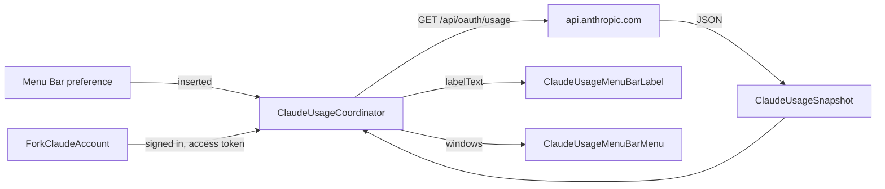

## Context

Tinycast's menu bar holds two independent `MenuBarExtra` scenes in `TinycastApp.body`. One is
Tinycast's own item, inserted by `showInMenuBar`. The other is the calendar item, inserted by
`calendarMenuBarDisplay`. `CalendarMenuBarLabel` reads `CalendarCoordinator` rather than the stores,
so Observation re-runs only the label. The scene reads a stored flag that changes only when it flips,
so `TinycastApp.body` and the main menu do not re-run on every tick
([calendar.md, "The menu bar"](../../../docs/features/calendar.md)).

`ForkClaudeAccount` owns the Claude OAuth tokens in Keychain. Its `accessToken()` refreshes an expired
token once, shares the in-flight refresh, and signs out when the refresh token is rejected. Its login
requests the `user:profile` and `user:inference` scopes among others
(`ForkClaudeAccountLogin.scopes`).

Claude Code 2.1.316 reads plan limits from `/api/oauth/usage`. Its binary names the windows
`five_hour`, `seven_day`, `seven_day_opus`, `seven_day_sonnet`, `seven_day_oauth`,
`seven_day_cowork` and `seven_day_overage`, and the fields `utilization`, `resets_at` and
`extra_usage`.

A `GET` with a Claude Code OAuth bearer token and no `anthropic-beta` header returns 200. The same
request with `anthropic-beta: oauth-2025-04-20` returns 401 `invalid x-api-key`. The 200 body has a
`limits` array. Each entry carries `kind` (`session`, `weekly_all`, `weekly_scoped`), `group`,
`percent` (an integer from 0 to 100), `severity` (`normal`, `warning`), `resets_at` (ISO 8601 with
fractional seconds and an offset), `is_active` and `scope.model.display_name`. The body also carries
`five_hour` and `seven_day` objects with `utilization` (a number from 0 to 100) and `resets_at`, plus
many keys that are `null` or unrelated to limits. The token that produced this body has the scopes
`user:file_upload`, `user:inference`, `user:mcp_servers`, `user:plugins`, `user:profile` and
`user:sessions:claude_code`.

## Goals / Non-Goals

**Goals:**

- Show the five-hour and weekly utilisation in the menu bar without opening a terminal.
- Follow the calendar item's ownership pattern: one preference, one coordinator, Observation scoped
  to the label.
- Reuse the existing Claude account token and refresh path.

**Non-Goals:**

- A generic, pluggable menu bar item framework. A second data source would justify one later.
- Reading Claude Code's own Keychain credential or local transcripts.
- Notifications or warnings when a limit is near.
- Spend, billing or extra-usage purchase flows.

## Decisions

**D1. A third independent `MenuBarExtra`, in the fork.** The scene, its binding and the coordinator
live under `Tinycast/Fork/ClaudeUsage/`. `TinycastApp` and `AppCore` gain one `// FORK: claude-usage`
hook each. The rejected alternative was adding rows to Tinycast's own menu. That alternative cannot
show a number in the bar and would edit an upstream menu.

**D2. Token from `ForkClaudeAccount`.** The coordinator calls `accessToken()`. A 401 response retries
once with `accessToken(rejectedToken:)`, which matches the provider's existing path. The rejected
alternative was reading Claude Code's Keychain item. That item belongs to another app and would need
a Keychain prompt.

**D3. Private ephemeral session.** The fetch uses a private `.ephemeral` `URLSession` with
`urlCache = nil`, per the networked-feature rule in `AGENTS.md`. Nothing is cached to disk. The last
snapshot lives in memory only.

**D4. Pure model.** `Fork/ClaudeUsage/Model/` holds three pieces, with no AppKit or SwiftUI import.
`ClaudeUsageSnapshot` decodes the `limits` array into windows. When `limits` is absent, the decoder
falls back to the `five_hour` and `seven_day` objects. Every other key is ignored. A window-ordering
function places `session` first, then `weekly_all`, then each `weekly_scoped` window named by its
model's display name. An unknown `kind` is shown under its raw value. A label formatter produces
`42%` or `42% · 18%` from the session and `weekly_all` windows. A body with neither source is a
failure, and the decoder never produces a partial snapshot. Harnesses compile these files directly.

**D8. No beta header.** The request sends only `Authorization: Bearer <token>`. An `anthropic-beta`
header makes the endpoint reject the token.

**D5. Polling lifecycle.** The coordinator polls every five minutes while two conditions hold. The
item must be inserted, and the account must be signed in. It also fetches once when either condition
becomes true, after the system wakes, and on **Refresh Now**. Each fetch carries a generation
identifier. A result whose generation is stale, or that arrives after the item is removed, is
dropped. A 429 response skips to the next scheduled poll.

**D6. Stored display state.** The coordinator stores `labelText` and `hasSnapshot`, and writes each
only when its value changes. The scene's insertion binding reads only the preference, so a poll never
re-runs `TinycastApp.body`.

**D7. Failure display.** After a failed fetch, the label keeps the last snapshot. The menu adds an
"Updated N min ago" line and the error's message. With no snapshot, the label shows the icon only.

## Risks / Trade-offs

- **Undocumented endpoint.** The endpoint can change shape or require a header that Claude Code sends.
  The decoder fails closed, and the item falls back to the icon with the error in the menu.
- **Scope mismatch.** The Tinycast login may lack a scope the endpoint requires. Task 1.1 confirms the
  scope against a real call before any UI work starts.
- **Rate limits.** Polling every five minutes adds 12 requests an hour per signed-in Mac. The interval
  is a constant in the model, so a harness can test the schedule.

## Open Questions

- **Q2.** Does the endpoint accept the token from Tinycast's own login, whose scopes
  include `org:create_api_key` and lack `user:plugins`? The native check in task 5.1 answers this.
