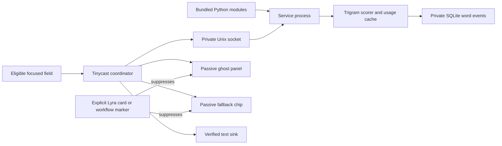

## Context

Tinycast supplies native word completion through Accessibility snapshots, a passive ghost panel, and a fallback chip.
The kitty Word Panel is retired.
The research ladder continues to use the production scorer and socket protocol.

## Decisions

### Bundled Python service

`Tinycast/Fork/Autocomplete/AutocompleteService/` contains `service.py`, `scorer.py`, `corpus.py`, and `index.py`.
`project.fork.yml` copies the directory as a folder resource for both Debug and Release.
The parent source scan in `project.yml` excludes the directory to prevent duplicate flattened resources.
The client resolves `service.py` through `Bundle.main` and launches `python3 -B` through `/usr/bin/env`.
Python bytecode stays outside the signed resource directory.
The host supplies Python 3; the app bundles no interpreter or third-party package.

The Swift client sends newline-delimited JSON through a private Unix socket.
Prediction requests contain the prefix and two preceding words.
Learning requests contain one completed word, its context, and an event identity.
The protocol carries no full-field text and writes no request logs.
The corpus reader retains its vault, shell-history, prompt-history, and Oxford dictionary sources.
The research ladder adds the repository service directory to its import path.

The scorer uses interpolated Kneser-Ney trigrams with discount 0.75.
A recent-word cache contributes weight 0.1 with a 2,000-word half-life.
Each context contributes at most 40 matching count leaders.
The scorer also considers 20 continuation leaders and 200 recent cache leaders.
Oxford words fill remaining positions below personal candidates.

### Persistence and lifecycle

The service retains the existing channel-specific Application Support paths and SQLite schema.
The `Autocomplete/learned.sqlite3` file has mode 600, and its directory has mode 700.
Each event commits before acknowledgment; its identity makes retries idempotent.
Startup replays learned events to reconstruct counts and cache ordering.
The implementation moves source files without reading or changing the production learned store.

An exclusive service lock permits one model process per channel.
Clients reuse a healthy service and stop only a child process they started.
Tinycast drains learning and insertion work before stopping its child.
A reused service remains outside Tinycast's termination ownership.
Recovery retries a failed request once while retaining the learning event identity.

### Field eligibility and exclusions

`autocomplete.excludedBundleIDs` replaces the allow-list in preferences and the settings-file schema.
The default list contains `com.microsoft.VSCode`, `com.apple.dt.Xcode`, `dev.zed.Zed`, and `com.1password.1password`.
Settings offers explicit add and remove controls for bundle IDs.
The retired allow-list does not restrict the new defaults.
Tinycast's own process and bundle remain excluded independently of this list.
Secure roles, secure subroles, and protected ancestors are checked before any field-value read.
The shared snapshot reader repeats that protection for stale-target checks.

Text fields, search fields, text areas, and combo boxes are eligible unless explicitly reported read-only.
Web areas and groups require an editable flag or a settable value attribute.
Generic cells, tables, grids, and static web content are ineligible.
A spreadsheet text editor can qualify through a text-field child.
Browser address bars qualify as text fields because the accepted scope includes all text fields.

The end-of-field boundary remains.
An unavailable value or selection range suppresses completion.
The ghost draws the suffix directly at the caret without NSTextField cell padding or an explicit horizontal gap.
Font estimation and application-specific caret accuracy remain subject to visual verification.

### Fallback chip

`ForkAutocompleteGhostController` owns both passive presentations in one panel slot.
A missing caret selects a chip containing the typed prefix in tertiary ink and the predicted suffix in primary ink.
The prefix retains the user's casing.
The chip uses the existing chip typography, spacing tokens, and native capsule glass.
Prediction, confidence, exclusions, secure-field guards, learning, and suffix insertion share the inline path.

Accessibility position and size place the chip below the focused field's bottom-left corner.
Horizontal placement stays within the visible display frame.
If the chip cannot fit below, placement tries above the field without covering its frame.
If neither position fits, `offscreen` suppresses presentation and leaves autocomplete keys unregistered.
A missing field frame selects the focused window's bottom-left interior instead.
Missing field and window frames produce `noAnchor` without a presentation.
Neither path uses mouse coordinates or invented coordinates.

Polling dismisses a displayed suggestion when its caret availability, caret bounds, or fallback frame changes.
Input callbacks timestamped before presentation cannot dismiss a newly presented suggestion.
Every successful offer records `presentationKind` as `inlineGhost` or `fallbackChip` under operation `autocomplete`.
Successful offers bypass the rejection limiter so a presentation-kind switch remains visible in diagnostics.
Suppression decisions retain the five-second limit per reason and process.

### Keyboard ownership

Typing schedules no Lyra Fix request or marker.
Autocomplete registers Tab and Escape only while its ghost or chip is visible.
An explicit Lyra card or workflow marker dismisses either presentation before registering Lyra keys.
The coordinator also checks Lyra ownership before presentation and acceptance.
Operation identity and live field checks reject stale predictions and insertions.
The text sink owns clipboard restoration when paste delivery is necessary.

### Learning and confidence

The native client learns ASCII words completed by delimiters in contiguous insertions of at most 256 UTF-16 units.
Deletion, selection replacement, and larger bulk edits generate no learning events.
Words containing digits or exceeding 30 characters are rejected.
Two preceding words supply context, and sentence punctuation resets context.
Clearing the same focused composer completes its final undelimited word.
Accessibility does not distinguish Send from another clear action.

The threshold defaults to 50 percent and accepts 0 through 100 percent.
Confidence is the first candidate's share of the top 30 candidate scores.
It is a ranking measure, not a calibrated correctness probability.

## Non-Goals

Terminal adapters, terminal acceptance keys, and terminal input learning belong to phase 2.
The existing explicit kitty Lyra selection card is independent of autocomplete.

## Verification boundary

The implementation worker performs source inspection and plain XcodeGen generation only.
Claude owns builds, harnesses, lint, fork audit, localization extraction, resource inspection, and import checks.
Sasha and the test agent own behavior checks across TextEdit, Slack, Obsidian, Mail, and VS Code.
The research ladder and caret probe are not run in phase 1.
No test files are written.
The fallback implementation receives source inspection only; Claude owns its Debug build and behavior checks.
The independent InputMethodKit prototype lives in `prototypes/imk-spike/` and has its own README and Makefile target.
Its single standalone Swift 6 compile is allowed; it has no Tinycast project or runtime dependency.
