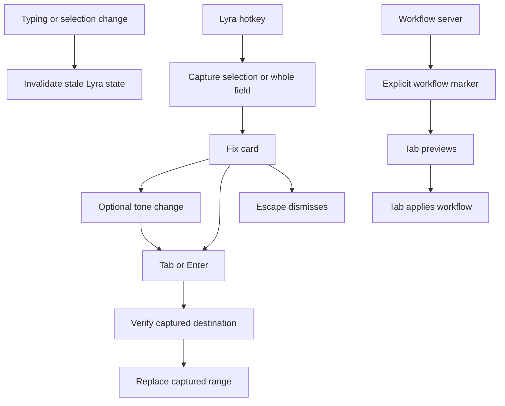

## Context

Lyra shares the focused editing surface with inline autocomplete.
Typing-triggered Fix competes for the same keys and presents a second suggestion surface.
The accepted interaction makes Lyra explicit and leaves typing assistance to autocomplete.

## Decisions

### Typing only invalidates

The coordinator retains focus, value, and selection observation to invalidate stale cards and workflow markers.
The typing path contains no debounce task, rewrite request, response comparison, or marker presentation.
The typed-Fix preference and settings-file binding are removed.
The old UserDefaults value is ignored without rewriting preferences outside the app.
The policy decoder retains timing fields and its delay helper because existing policy files and harnesses reference that contract.
No production typing path consumes the delay helper.

### Fix starts the card

`openPanel()` captures the selected range or the whole field when the selection is empty.
The policy projection places Fix first and retains the configured order of other modes.
A policy without Fix leaves the hotkey unavailable.
The hotkey uses the panel text-rewrite path, avoiding the automatic Fix word-count and character-count gate.
The headless API and workflow selection limits retain their existing behavior.

The card displays the selected mode and previous-mode and next-mode buttons.
The default modes are Fix, Refine, Professional, and Friendly.
Keys 1–4 select those four positions; arrows and card buttons cycle through configured modes.
Each mode request retains its policy snapshot and operation identity.
Changes to focus, text, selection, or policy cancel the old request.

### Keyboard ownership

The hidden state registers no temporary Lyra keys.
The rewrite card registers Tab, Enter, Escape, mode digits, and arrow keys.
Acceptance remains unavailable during loading, partial streams, and error states.
Before Lyra claims keys, its existing presentation callback hides autocomplete and releases autocomplete keys.
Autocomplete rechecks Lyra ownership before displaying or inserting a prediction.

### Kitty and workflows retain delivery boundaries

The existing kitty path reads a selected string through remote control and presents its Copy-only card near the mouse.
Fix becomes the first mode without adding terminal autocomplete or terminal insertion.
Tab and Enter copy a completed kitty result and dismiss the card.

`presentWorkflowMarker`, workflow writing ownership, preview, completion callbacks, and selection delivery remain.
The automatic typing scheduler is separate from these explicit workflow operations.
The model server, endpoint, and ownership implementation remain unchanged.

## Verification boundary

The implementation worker writes no tests and runs no apps, builds, typecheck, lint, or harnesses.
Claude owns builds and existing checks.
New tests wait for Sasha's behavior verification.
Plain XcodeGen generation is allowed.
The change remains open until the card, workflow, secure-field, and autocomplete interactions pass the assigned checks.
