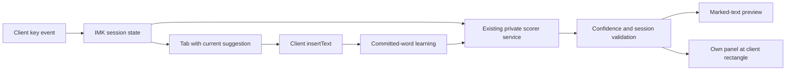

# InputMethodKit geometry spike

This prototype checks whether an enabled InputMethodKit (IMK) input method receives usable caret metadata in ordinary editing applications.
It observes key-down callbacks, returns `false` for every event, commits no text, and creates no windows or marked text.
The callback reads no event characters, text substrings, field values, or clipboard content.

The Makefile defines an independent `build` target outside the Tinycast Xcode project.
Tinycast builds do not include the prototype.
The fallback chip ships independently of this experiment.

## Build

From the repository root, with Xcode selected:

```sh
make -C prototypes/imk-spike build
```

The target compiles for the host architecture and macOS 26 using Swift 6 with complete strict concurrency.
It creates `prototypes/imk-spike/build/Tinycast IMK Spike.app`.
The build copies `Info.plist` and compiles only `IMKSpike.swift` against Apple frameworks.
It performs no installation, registration, input-source selection, network request, or log-directory creation.

The bundle identifier is `com.tinycast.inputmethod.imk-spike`.
The connection name is `com.tinycast.inputmethod.imk-spike_Connection`.
The controller has the explicit Objective-C runtime name `TinycastIMKSpikeController`, matching the property list.
The property list declares a keyboard input method with English language and Latin script metadata.

One build of this target completed with exit code 0 and no compiler diagnostics on arm64.
No prototype launch or registration was performed.

## Enable in four steps — Sasha or Claude only

1. Build, optionally sign, and copy the bundle into `~/Library/Input Methods/Tinycast IMK Spike.app` using the commands below.
2. If macOS does not discover the source, log out and log back in before opening Input Sources again.
3. Open **System Settings → Keyboard → Text Input → Edit… → Input Sources → +**. Search for **Tinycast IMK Spike**, check English if necessary, select it, and click **Add**.
4. Select **Tinycast IMK Spike** in the menu-bar Input menu before typing in each application under test.

Installation commands, for manual execution after building:

```sh
# Optional local ad-hoc signing; the target only signs the bundle in this repository.
make -C prototypes/imk-spike sign
mkdir -p "$HOME/Library/Input Methods"
ditto "prototypes/imk-spike/build/Tinycast IMK Spike.app" \
    "$HOME/Library/Input Methods/Tinycast IMK Spike.app"
```

For an existing Apple signing identity, the signing command accepts an explicit identity:

```sh
make -C prototypes/imk-spike sign SIGN_IDENTITY='Apple Development: YOUR EXISTING IDENTITY'
```

The build target does not request a signing identity or sandbox entitlements.
The explicit signing target defaults to ad-hoc signing.
Discovery under a local signature and any macOS 26 or 27 signing requirement remain unverified.
No definitive modern signing or logout requirement was found in the inspected Apple documentation and SDK headers.
Logging out is a manual discovery retry, not a verified requirement for every installation.

Apple documents the input-method installation directories and distinguishes keyboard input methods from palette input methods.
This prototype declares the keyboard type and provides no self-registration path.
[Apple input-method management](https://developer.apple.com/library/archive/qa/qa1810/_index.html)

Apple's Input Sources instructions describe Keyboard, Text Input, Edit, Add, and menu-bar selection.
The exact discovery category of this development bundle needs manual confirmation.
[Apple Input Sources settings](https://support.apple.com/en-ie/guide/mac-help/mchl84525d76/27/mac/27)

## Remove

Select the usual keyboard source first.
In **System Settings → Keyboard → Text Input → Edit…**, select **Tinycast IMK Spike** and click **−**.
Move only `~/Library/Input Methods/Tinycast IMK Spike.app` to the Trash using Finder.
Log out and back in if macOS retains the running prototype or its menu entry.
The metadata log can remain for review or be removed separately through Finder.
No Tinycast preference, scorer store, or existing keyboard source belongs to this removal.

## Metadata log

The running prototype appends JSON Lines to:

```text
~/Library/Application Support/com.tinycast.imk-spike/events.jsonl
```

The directory has mode `700`, and the file has mode `600` before each write.
The writer rejects symlinks, non-regular files, different owners, and multiply linked files.
A serial utility queue writes encoded metadata and closes each descriptor after its append.
Only Sendable metadata crosses to that queue; the client and event remain inside the synchronous callback.
Write failures produce a fixed system-log message without error descriptions or user content.

| Field | Meaning |
| --- | --- |
| `timestamp` | Wall-clock callback time in ISO 8601 format. |
| `clientBundleID` | Validated client bundle identifier, omitted when unavailable. |
| `clientAvailable` | Whether the sender conforms to the IMK text-input protocol. |
| `rectQueryAvailable` | Whether the client exposes the formal caret-query protocol. |
| `rectNonZero` | Whether the returned finite rectangle differs from the zero rectangle. |
| `rectUsable` | Whether the rectangle is finite and has positive height; zero-width carets qualify. |
| `rectWidth`, `rectHeight` | Returned size in screen points, omitted for non-finite dimensions. |
| `selectedRangeAvailable` | Whether both selection components differ from `NSNotFound`. |
| `lengthAvailable` | Whether document length is non-negative and differs from `NSNotFound`. |
| `markedAttributesAvailable` | Whether `validAttributesForMarkedText` returns an array, including an empty array. |
| `markedAttributeCount` | Number of reported marked-text attributes, omitted when unavailable. |

The log contains no key code, modifier flags, characters, text, attribute values, selection offsets, document lengths, or rectangle coordinates.
`rectQueryAvailable` describes protocol availability; `rectUsable` describes the returned result.
An empty attribute array does not prove that marked text is unsupported.

Each key-down callback queries `attributes(forCharacterIndex: 0, lineHeightRectangle:)`.
Apple's `IMKInputSession.h` specifies index `0` for the current selection when no inline session exists.
The observations precede the client's handling of that key because the callback returns `false` afterward.
The position therefore describes the pre-key state and may lag asynchronous client layout.
Apple also warns that selection and length can return `NSNotFound`, and that document-length queries may be expensive.
The per-key length query is intentional for this bounded experiment.
[Apple InputMethodKit](https://developer.apple.com/documentation/inputmethodkit)

## Test-agent procedure — manual, after enablement

Use disposable local drafts and keep the prototype selected in every test application.
Type `the quick brown fox`, then a space, backspace, arrow left, Tab, and Escape.
Confirm that the application receives the same editing operations as with the ordinary keyboard source.
The prototype must show no panel, underline, candidate, or committed text of its own.
Do not submit messages or execute a terminal command containing the sample text.

| Application and field | Coverage |
| --- | --- |
| TextEdit, new plain-text document | Native text-input baseline. |
| Chrome, disposable textarea | Browser form editing. |
| Chrome, disposable contenteditable element | Browser rich-text editing. |
| Slack, unsent draft in a permitted scratch conversation | Electron composer. |
| Obsidian, disposable unsaved scratch editor | Electron editor. |
| kitty, shell input line without pressing Return | Terminal cursor metadata. |
| Another installed terminal, shell input line without pressing Return | Separate terminal implementation. |

For each field, note the client bundle identifier and the wall-clock test interval outside the metadata log.
Inspect that interval for successive records, `rectUsable`, reported size, selection availability, length availability, and marked-attribute availability.
Resize or move the window and type again to check that positive metadata continues across layout changes.
The size-only log cannot prove that rectangle coordinates track the caret accurately.
Visual caret tracking needs a separately authorized panel experiment.

Use Chrome password-field focus as a negative control without entering a password.
Absence of callbacks there is expected from Chromium source and does not establish ordinary-field failure.
An app with no records is **unverified for event delivery**, not a zero-rectangle result.
Do not treat the presence of any single record as evidence that every key reaches the input method.

A useful initial result needs repeated ordinary-field callbacks and positive-height rectangles in Chrome, Electron, and kitty.
Missing selection or length is a separate limitation even if geometry succeeds.
The spike does not test ghost rendering, insertion, Tab interception, learning, dead keys, non-Latin layouts, or coexistence with another input method.

## Design if the geometry experiment passes

A full input method could own completion state per IMK input session and request predictions from the existing private scorer socket.
It would send the same two-word context and prefix and apply the same confidence and app-exclusion rules.
An integration would need an explicit Tinycast channel and service owner because the prototype's bundle identifier is outside the scorer's accepted channels.
The prototype starts no service and connects to no socket.



Marked text could preview a suffix through `setMarkedText`, subject to each client's supported attributes and composition behavior.
This changes client composition state, so invisible cancellation, surrounding-text preservation, and typed-prefix handling require verification.
An own passive panel at the reported rectangle could avoid placing speculative characters inside the client's document.
Both rendering approaches remain unverified.

While a current suggestion exists, the input method could consume Tab and call the client's `insertText` for the suffix without paste.
All other events would follow explicit pass-through and dismissal rules.
The implementation would need session identity, focus checks, cancellation, and verified selection semantics before asynchronous prediction results can insert text.
Learning would record only committed words and delimiters, with acknowledgment and event identity matching the existing service.
Reconstructing committed words from pass-through events, deletions, external edits, and app-specific commands remains unverified.
Switching to a different input method would remove this input method from the active path.

## Source findings and open questions

**Caret access from a non-input-method app:** no public cross-process bypass was found when Accessibility supplies no caret geometry.
`NSTextInputClient.firstRect` is a client method, and `NSTextInputContext` owns a local client reference; neither exposes an arbitrary application's client by process identifier.
Chromium's implementation asks its own host for geometry and can return a zero rectangle on failure.
That supports trying IMK, without establishing universal coverage or an external caret API.
[Apple text-client rectangle](https://developer.apple.com/documentation/appkit/nstextinputclient/firstrect(forcharacterrange:actualrange:)), [Apple input context](https://developer.apple.com/documentation/appkit/nstextinputcontext), [Chromium text client](https://github.com/chromium/chromium/blob/main/content/app_shim_remote_cocoa/render_widget_host_view_cocoa.mm#L2602)

**Kitty protocol support:** kitty's Cocoa view implements `NSTextInputClient`, including `firstRectForCharacterRange`.
The method obtains cursor-cell coordinates from `get_ime_cursor_position`, accounts for display scale, and converts the rectangle to screen coordinates.
It returns the cached rectangle if the callback supplies no update.
Its marked-text attribute list is empty.
This establishes source support, not installed-version behavior or protocol coverage in other terminals.
[Kitty Cocoa text client](https://github.com/kovidgoyal/kitty/blob/bb1aca6f279f1a5cfa3edd765a71650fe91b6472/glfw/cocoa_window.m#L2226)

Sasha and Claude own discovery, key delivery, and geometry measurements before choosing a production input-method approach.
Claude owns the fallback chip's Tinycast build and behavior checks independently of that decision.
